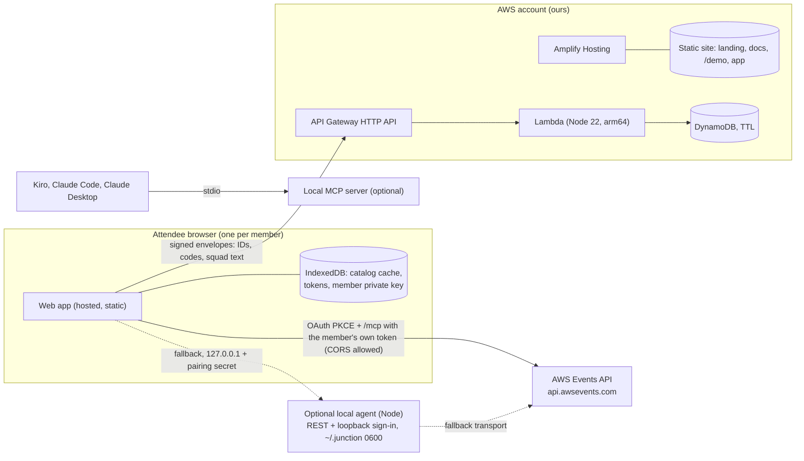

# 02. Architecture

## Shape

Three things live in three trust zones.

| Zone | What runs | Holds secrets | Sees catalog | Talks to Events API |
|---|---|---|---|---|
| Attendee browser (or optional local agent) | Web app, solver, signing | Events API tokens, member private key | Yes, its own copy | Yes, with its own token |
| AWS account (ours) | Amplify hosting, squad server | None of the members' | No | Never |
| Hosted demo (same app, demo mode) | Same UI compiled with fixtures | None | Fictional data only | No, no network calls at all |

## Where sign-in runs (ADR-012)

The API signs attendees in with OAuth code plus PKCE, and the redirect URIs are six reserved loopback addresses on ports 8484 to 8489, matched exactly with no wildcards. The guide says "There is no hosted option. An application you distribute runs on each attendee's machine." Probes on 2026-10-01 (docs/04) show the token endpoint and `/mcp` accept browser origins, while the REST routes do not answer CORS preflight. So the primary path is a hosted web app that runs the sign-in in the member's own browser and calls `/mcp`; the redirect lands on `http://localhost:848x/callback` where nothing listens, and the member pastes that URL back (or runs the optional agent, which catches it). Tokens stay in that browser and never reach our backend. **Risk:** the quoted sentence is a policy statement. Spike 0 validates the path and the hackathon rules; if it is refused, the local agent becomes primary with no change to core, relay or the UI.

## Components

### Core (`packages/core`)

Pure TypeScript, no I/O, no clock, no randomness. Schemas, canonical JSON, signing helpers, code parser, repeat groups, coverage, solver, claim rule, venue graph. Everything the determinism guarantee depends on lives here and nowhere else. Runs unchanged in the browser, Node and Lambda (hence `@noble/*` crypto, not `node:crypto`).

### Web app (`packages/web`, primary)

React and Vite, plain CSS on `design/tokens.css`, hosted on Amplify Hosting.
- Sign-in: PKCE verifier from the Web Crypto CSPRNG, `state`, redirect to `http://localhost:848x/callback`, member pastes the callback URL, code exchange at the token endpoint, refresh serialised (Web Locks API) so two tabs never race. Tokens in IndexedDB of the app origin, never in `localStorage`, never logged. Strict CSP, no third-party scripts, so a compromised dependency cannot read them.
- Events API client behind a `Transport` interface: `McpTransport` (primary, `https://api.awsevents.com/mcp`) and `AgentTransport` (fallback, REST through the local agent). Typed, zod-validated, per-operation token buckets, `Retry-After`, closed-operation handling, reconcile-before-retry for writes.
- Catalog store: IndexedDB with snapshots, diffs, lazy abstracts, repeat groups, venue normaliser.
- Member key: Ed25519 generated in the browser, stored in IndexedDB as a non-extractable key where supported, with a downloadable encrypted backup so clearing the browser does not orphan the member.
- Sync: reads `GetSchedule`, builds and signs the member's manifest, pulls and verifies the others, runs the solver, stores proposals.
- Builds: the app and the demo build (fixtures, no network, deployed to `/demo`). Same components, different data source behind one interface.

### Local agent (`packages/agent`, optional fallback)

Used only if the browser path is refused (ADR-012) or for members who prefer it. Loopback sign-in with port fallback (8484 to 8489), tokens in `~/.junction/credentials.json` (0600), REST transport, `node:sqlite` behind a `CatalogStore` interface, CLI (`junction login`, `logout`, `sync`, `catalog stats`, `squad create|join|approve|leave`, `export`, `import`, `ui`, `mcp`, `doctor`). Its HTTP server listens on `127.0.0.1:4848` (outside the callback range 8484 to 8489, which stays free for sign-in and for Claude Code's MCP setup). **Defences:** loopback only, `Host` allowlist (blocks DNS rebinding), random per-launch pairing secret required on every call, `Origin` must equal the hosted app's exact origin or the server itself (no wildcard CORS), strict CSP.

### Local MCP server (`packages/mcp`)

stdio server using the MCP SDK, reads only local state. Complements the official `awsevents` MCP server; it does not proxy it.

### Squad server (`packages/relay` and `infra`)

A mailbox. API Gateway HTTP API, one Lambda with a small router, DynamoDB single table on-demand with TTL. It verifies signatures, enforces membership from the latest signed charter, stores envelopes, and performs conditional writes for claims. It cannot read anything sensitive because nothing sensitive is sent.

## AWS infrastructure (CDK v2, TypeScript, `infra/`)

Dedicated AWS account, region **us-east-1**. Bootstrap once with `cdk bootstrap`. Hosting is Amplify; the backend is CDK.

**Site: Amplify Hosting** (connected to `github.com/codecr/junction-hackhaton`, branch `main`, monorepo app root `packages/web`)
- Amplify builds the app and the demo build on every push, serves them from its CDN (HTTPS, HTTP/2), SPA rewrite for `/demo/*` and the app routes.
- Custom response headers (`customHttp.yml`): `Content-Security-Policy: default-src 'self'; img-src 'self' data:; font-src 'self'; style-src 'self'; script-src 'self'; connect-src 'self' https://api.awsevents.com https://oauth.awsevents.com <relay API origin> http://127.0.0.1:4848; frame-ancestors 'none'` (the demo build gets `connect-src 'self'` only), HSTS, `X-Content-Type-Options`, `Referrer-Policy: no-referrer`.
- Custom domain optional, through Amplify domain management.
- Amplify manages only hosting. No Amplify Gen 2 backend, so DynamoDB conditional writes and signature checks stay in our own Lambda.

**JunctionRelayStack**
- DynamoDB table `junction`, on-demand, PK `pk` (string), SK `sk` (string), TTL attribute `ttl`, point-in-time recovery off (data is disposable), deletion protection off, removal policy DESTROY.
- Lambda `relay` (NodejsFunction, Node 22, arm64, 256 MB, timeout 10 s, reserved concurrency 20, no VPC, log retention 30 days, `NODE_OPTIONS=--enable-source-maps`).
- API Gateway HTTP API, routes in docs/03, default throttling rate 20 and burst 40, CORS allows only the exact app origin(s) and the `Authorization: Junction ...` and `Content-Type` headers (the browser calls it now; auth is the Ed25519 signature, never cookies), access logs without bodies.
- Alarms: Lambda errors and throttles, API 5xx, DynamoDB throttled requests, all to an SNS topic with the owner's email.
- AWS Budgets: monthly cost budget at 25 USD with 50, 80 and 100 percent alerts.
- Outputs: API URL, site URL, table name.

Estimated cost during the hackathon: under 5 USD a month, dominated by CloudFront and any custom domain.

## Data flows

**Sign-in (browser path).** The web app creates the PKCE verifier and `state`, opens `https://oauth.awsevents.com/oauth2/authorize` with `redirect_uri=http://localhost:8484/callback`, Builder ID sign-in happens in the browser, the browser lands on a dead `localhost` address, the member pastes that URL into the app, the app checks `state`, exchanges the code at the token endpoint with the identical `redirect_uri` string, stores tokens in its own IndexedDB, and never transmits them anywhere else. **Fallback:** the local agent runs the listener and exchange itself.

**Sync (every few minutes and on demand).** `GetSchedule` (60 per minute) → build and sign manifest → `PUT` to the squad server (or write a file) → pull other members' envelopes → verify signatures and sequence numbers → run solver → store proposals → UI updates.

**Accept a proposal.** The app performs the member's own writes through the active `Transport` (`AssociateFavorites`, `ReserveSessions`, `CancelReservation`, `CreatePersonalTime`) within quota → `GetSchedule` to confirm → report per-session results → next manifest reflects the change.

**Launch reactor.** Catalog poll → diff shows new sessions → classify → claim rule ranks eligible members → owner is prompted first, others after their grace period → claim posted to the squad server with a conditional write → winner returned to every loser.

## Security and threat model

| Threat | Mitigation |
|---|---|
| Squad server compromised or curious | Only signed IDs and codes are stored. It cannot forge manifests (Ed25519 keys are local). At worst it withholds or drops messages, which degrades to file exchange. |
| Malicious or removed member | Membership comes from the leader-signed charter. Removed members' envelopes are rejected after the new charter propagates. Manifests are ignored if `seq` is stale. |
| Leaked invite code | The leader approves every join request. Invite secrets are single-squad and can be rotated by publishing a new charter with a new verifier. |
| Replay of signed requests | Timestamp window of 120 seconds plus a nonce recorded with a 10 minute TTL by a conditional put. |
| Token theft from the browser (XSS, malicious dependency) | Strict CSP with `script-src 'self'`, no third-party scripts, locked and audited dependencies, tokens in IndexedDB (never `localStorage`), short-lived access token, sign-out revokes the refresh token. Residual risk is higher than the agent's 0600 file, which is why the agent stays as fallback. |
| Token theft on the attendee machine (agent) | 0600 file, never logged, never sent off machine, `.claude/settings.json` denies reading `~/.junction/**`, sign-out revokes the refresh token. |
| Other websites attacking the local agent | Loopback bind, Host allowlist, per-launch pairing secret, exact-origin check, strict CSP, no wildcard CORS. |
| Browser path refused by AWS or the rules | Transport interface isolates it. Switching to the agent changes no core, relay or UI code. |
| Catalog leakage | Titles and abstracts stay in the local store and are never serialised into manifests or logs. Repo hygiene enforced by `.gitignore`, a pre-commit check and the `guardian` subagent. |
| Supply chain | Lockfile, pinned versions, `npm audit` in CI, no postinstall scripts from unknown packages, Dependabot, provenance when publishing. |
| Abuse of the public squad server | Throttling, small payload cap (64 KB), reserved concurrency, budget alarm, TTL on everything. |

## Decision records

| ID | Decision | Why |
|---|---|---|
| ADR-001 | ~~Local agent, not a hosted app~~ Superseded by ADR-012 | The API only supports loopback sign-in and says there is no hosted option. We want a web app members can actually use. |
| ADR-002 | Identity is a keypair per member, not accounts | No sign-up, no passwords, nothing to breach. Builder ID stays with the Events API. |
| ADR-003 | Deterministic solver on every machine, no coordinator | Removes a trusted central party and works offline. |
| ADR-004 | Squad server is a mailbox, primary transport in the hosted app | Resilience and privacy. It stores only the fields listed in CLAUDE.md rule 2. File and paste always work if it is down. |
| ADR-005 | Manifests carry IDs and codes only | The catalog is not public. Minimises what could ever leak. |
| ADR-006 | TypeScript monorepo, Node 22, npm workspaces | One language across agent, core, relay, web and infra. |
| ADR-007 | Plain CSS on tokens, no UI kit | Distinct look, no template tells. See docs/05. |
| ADR-008 | IndexedDB catalog store in the web app; `node:sqlite` behind a `CatalogStore` interface in the agent | About 2,000 sessions fit in memory. `better-sqlite3` is a native module, which breaks easy installs on members' machines. |
| ADR-009 | Demo mode is a build of the same UI with no network | Judges can try it without signing in and without catalog data. |
| ADR-010 | us-east-1, dedicated account, serverless only, no relational databases | Clean blast radius, repeatable deploys, near-zero idle cost. |
| ADR-011 | Working name "Junction" | Lines meet at a junction. Trivial to rename; keep the name in one constants file. |
| ADR-012 | Hybrid sign-in: browser PKCE plus `/mcp` is primary, local agent is the fallback | On 2026-10-01 the token endpoint and `/mcp` allowed browser origins, REST preflight returned 404 (docs/04). The guide still says there is no hosted option, so Spike 0 and the hackathon rules must confirm. `Transport` interface keeps the swap cheap. |
| ADR-013 | Manifests carry `holds`, and proposals are independent per member | Declines live on one machine, so other agents would plan around a change that never happens. Holds travel in the signed manifest; each proposal is computed against the current schedule, not a chain of earlier moves. See docs/03. |
| ADR-014 | Amplify Hosting for the site, CDK for the backend | CI from GitHub with no hosting stacks to maintain, while signature checks and DynamoDB conditional writes stay in our own Lambda (Amplify Gen 2 data would put AppSync in front of them). |
| ADR-015 | CI matrix on Linux, macOS and Windows, LF line endings enforced | Byte-identical solver output is the core promise and the author develops on Windows. `.gitattributes` forces LF so golden fixtures do not drift. |
| ADR-016 | Local agent UI port is 4848, outside the OAuth callback range | 8484 is the first callback port and Claude Code's MCP setup uses it. |

Add new records here as they are made.

## Deployment steps

1. `aws sso login --profile <profile>` and `export AWS_PROFILE=<profile>`.
2. `npm run build` (web, web demo, relay, agent).
3. `npx cdk bootstrap aws://<account>/us-east-1` (first time only).
4. `npm run infra:diff`, review, then `npm run infra:deploy` (relay backend). The site deploys by pushing to `main` once, after connecting the repo in the Amplify console.
5. Smoke tests: site loads, `/demo` runs with the network tab empty, relay `GET /v1/health` returns 200, a signed test envelope round-trips from the app origin (CORS), an unsigned one is rejected.
6. Run the `guardian` subagent. It must pass before announcing the URL.
