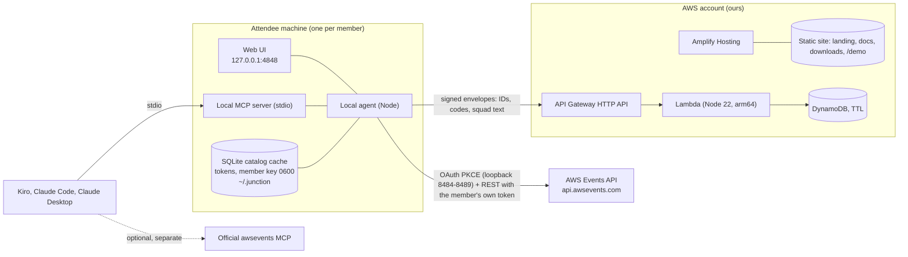

# 02. Architecture

## Shape

Three things live in three trust zones.

| Zone | What runs | Holds secrets | Sees catalog | Talks to Events API |
|---|---|---|---|---|
| Attendee machine | Local agent, web UI, MCP server, solver, signing | Events API tokens, member private key | Yes, its own copy | Yes, with its own token |
| AWS account (ours) | Amplify hosting (static), squad server | None of the members' | No | Never |
| Browser on the hosted demo | Same UI compiled in demo mode | None | Fictional data only | No, no network calls at all |

## Where sign-in runs (ADR-012)

The guide page `auth-signing-in` says: "Your application must run on the attendee's machine. It listens at `/callback` on one of six reserved loopback ports, `8484` through `8489`. […] There is no hosted redirect URI, so you can distribute an application that signs attendees in, but it has to run locally." The page `what-is-events-api` adds "There is no hosted option." So sign-in and every Events API call run in the local agent, and the agent serves the web UI to the member's own browser at `127.0.0.1:4848`. The decision was made on 2026-10-01 after weighing a browser-side alternative.

That alternative is technically possible: probes the same day (docs/04) showed the token endpoint and `/mcp` accept browser origins, while the REST routes fail CORS preflight. It is **not built**. It contradicts the sentence above, and the page `auth-handling-tokens` would also force tokens to live in memory only, with a fresh sign-in on every reload. It stays a Spike 0 experiment and is only adopted with written confirmation from the hackathon organizers or AWS. If that arrives, it adds a second `Transport` implementation and a hosted build of the UI; core and relay do not change.

## Components

### Core (`packages/core`)

Pure TypeScript, no I/O, no clock, no randomness. Schemas, canonical JSON, signing helpers, code parser, repeat groups, coverage, solver, claim rule, venue graph. Everything the determinism guarantee depends on lives here and nowhere else. Runs unchanged in Node, Lambda and the browser (the demo build runs the solver client-side, hence `@noble/*` crypto, not `node:crypto`).

### Local agent (`packages/agent`)

- Sign-in: PKCE verifier from a CSPRNG, `state`, loopback listener on 8484 with fallback through 8489 (open only while signing in), token storage in `~/.junction/credentials.json` (0600), refresh serialised so two refreshes never race.
- Events API client: types generated from the official OpenAPI (`https://api.awsevents.com/v1/openapi.json`), zod-validated, per-operation token buckets, `Retry-After` handling, closed-operation handling, reconcile-before-retry for writes. Behind a `Transport` interface so another surface can be added later.
- Catalog store: `node:sqlite` (built into Node 22.13+, no native build) behind a `CatalogStore` interface, with snapshots, diffs, lazy abstracts, repeat groups, venue normaliser.
- Member key: Ed25519 generated on first run, stored in `~/.junction/` (0600), with an encrypted export for backup.
- Sync: reads `GetSchedule`, builds and signs the member's manifest, pulls and verifies the others (squad server, file or paste), runs the solver, stores proposals.
- Local HTTP server: serves the built web UI and a small JSON API on `127.0.0.1:4848` (outside the callback range 8484 to 8489, which stays free for sign-in and for Claude Code's MCP setup). **Defences:** loopback only, `Host` allowlist (blocks DNS rebinding), random per-launch secret required on every state-changing call, `Origin` must be the server itself, strict CSP, no CORS. The browser never receives a token.
- CLI: `junction login`, `logout`, `sync`, `catalog stats`, `squad create|join|approve|leave`, `export`, `import`, `ui`, `mcp`, `doctor`.
- Distribution: `npx` from a GitHub release, UI prebuilt inside, no native modules.

### Web UI (`packages/web`)

React and Vite, plain CSS on `design/tokens.css`. Two builds: the agent-served app (talks to the local agent) and the demo build (fictional fixtures, no network, hosted at `/demo`). Same components, different data source behind one interface. It runs no sign-in code and holds no token.

### Local MCP server (`packages/mcp`)

stdio server using the MCP SDK, reads only local state. Complements the official `awsevents` MCP server; it does not proxy it.

### Squad server (`packages/relay` and `infra`)

A mailbox. API Gateway HTTP API, one Lambda with a small router, DynamoDB single table on-demand with TTL. It verifies signatures, enforces membership from the latest signed charter, stores envelopes, and performs conditional writes for claims. It cannot read anything sensitive because nothing sensitive is sent.

## AWS infrastructure (CDK v2, TypeScript, `infra/`)

Dedicated AWS account, region **us-east-1**. Bootstrap once with `cdk bootstrap`. Hosting is Amplify; the backend is CDK.

**Site: Amplify Hosting** (connected to `github.com/codecr/junction-hackhaton`, branch `main`, monorepo app root `packages/web`)
- Amplify builds the landing page, docs, downloads and the demo build on every push, serves them from its CDN (HTTPS, HTTP/2), SPA rewrite for `/demo/*`. The hosted site never calls the Events API and never calls the squad server.
- Custom response headers (`customHttp.yml`): `Content-Security-Policy: default-src 'self'; img-src 'self' data:; font-src 'self'; style-src 'self'; script-src 'self'; connect-src 'self'; frame-ancestors 'none'`, HSTS, `X-Content-Type-Options`, `Referrer-Policy: no-referrer`.
- Custom domain optional, through Amplify domain management.
- Amplify manages only hosting. No Amplify Gen 2 backend, so DynamoDB conditional writes and signature checks stay in our own Lambda.

**JunctionRelayStack**
- DynamoDB table `junction`, on-demand, PK `pk` (string), SK `sk` (string), TTL attribute `ttl`, point-in-time recovery off (data is disposable), deletion protection off, removal policy DESTROY.
- Lambda `relay` (NodejsFunction, Node 22, arm64, 256 MB, timeout 10 s, reserved concurrency 20, no VPC, log retention 30 days, `NODE_OPTIONS=--enable-source-maps`).
- API Gateway HTTP API, routes in docs/03, default throttling rate 20 and burst 40, CORS closed (the agent calls it server-side, browsers never call it), access logs without bodies.
- Alarms: Lambda errors and throttles, API 5xx, DynamoDB throttled requests, all to an SNS topic with the owner's email.
- AWS Budgets: monthly cost budget at 25 USD with 50, 80 and 100 percent alerts.
- Outputs: API URL, site URL, table name.

Estimated cost during the hackathon: under 5 USD a month, dominated by CloudFront and any custom domain.

## Data flows

**Sign-in.** UI or CLI asks the agent to start the loopback listener, the agent opens `https://oauth.awsevents.com/oauth2/authorize` (with `identity_provider=AWSBuilderID`, `code_challenge_method=S256`) and Builder ID sign-in happens in the browser. The browser returns a code to `localhost:848x/callback`, the agent checks `state`, exchanges the code at the token endpoint with the identical `redirect_uri` string, stores tokens in `~/.junction/`, closes the listener, and never transmits them anywhere else.

**Sync (every few minutes and on demand).** `GetSchedule` (60 per minute) → build and sign manifest → `PUT` to the squad server (or write a file) → pull other members' envelopes → verify signatures and sequence numbers → run solver → store proposals → UI updates.

**Accept a proposal.** UI asks the agent → agent performs the member's own writes (`AssociateFavorites`, `ReserveSessions`, `CancelReservation`, `CreatePersonalTime`) within quota → `GetSchedule` to confirm → report per-session results → next manifest reflects the change.

**Launch reactor.** Catalog poll → diff shows new sessions → classify → claim rule ranks eligible members → owner is prompted first, others after their grace period → claim posted to the squad server with a conditional write → winner returned to every loser.

## Security and threat model

| Threat | Mitigation |
|---|---|
| Squad server compromised or curious | Only signed IDs and codes are stored. It cannot forge manifests (Ed25519 keys are local). At worst it withholds or drops messages, which degrades to file exchange. |
| Malicious or removed member | Membership comes from the leader-signed charter. Removed members' envelopes are rejected after the new charter propagates. Manifests are ignored if `seq` is stale. |
| Leaked invite code | The leader approves every join request. Invite secrets are single-squad and can be rotated by publishing a new charter with a new verifier. |
| Replay of signed requests | Timestamp window of 120 seconds plus a nonce recorded with a 10 minute TTL by a conditional put. |
| Token theft on the attendee machine | 0600 file, never logged, never in a URL, never sent off machine, `.claude/settings.json` denies reading `~/.junction/**`, sign-out revokes the refresh token. The UI never receives a token. |
| Other websites attacking the local agent | Loopback bind, Host allowlist (blocks DNS rebinding), per-launch secret, Origin check, strict CSP, no CORS. |
| Hosted site compromised | It is static, holds no secrets, and the agent trusts nothing it serves. Downloads carry checksums and release provenance. |
| Catalog leakage | Titles and abstracts stay in the local store and are never serialised into manifests or logs. Repo hygiene enforced by `.gitignore`, a pre-commit check and the `guardian` subagent. |
| Supply chain | Lockfile, pinned versions, `npm audit` in CI, no postinstall scripts from unknown packages, Dependabot, provenance when publishing. |
| Abuse of the public squad server | Throttling, small payload cap (64 KB), reserved concurrency, budget alarm, TTL on everything. |

## Decision records

| ID | Decision | Why |
|---|---|---|
| ADR-001 | Local agent, not a hosted app | The API only supports loopback sign-in and says "it has to run locally" (`auth-signing-in`). Reaffirmed by ADR-012. |
| ADR-002 | Identity is a keypair per member, not accounts | No sign-up, no passwords, nothing to breach. Builder ID stays with the Events API. |
| ADR-003 | Deterministic solver on every machine, no coordinator | Removes a trusted central party and works offline. |
| ADR-004 | Squad server is a mailbox, the default transport | Resilience and privacy. It stores only the fields listed in CLAUDE.md rule 2. File and paste always work if it is down. |
| ADR-005 | Manifests carry IDs and codes only | The catalog is not public. Minimises what could ever leak. |
| ADR-006 | TypeScript monorepo, Node 22, npm workspaces | One language across agent, core, relay, web and infra. |
| ADR-007 | Plain CSS on tokens, no UI kit | Distinct look, no template tells. See docs/05. |
| ADR-008 | `node:sqlite` behind a `CatalogStore` interface | Diffs and queries over about 2,000 sessions with no native build. `better-sqlite3` would break easy installs on members' machines. |
| ADR-009 | Demo mode is a build of the same UI with no network | Judges can try it without signing in and without catalog data. |
| ADR-010 | us-east-1, dedicated account, serverless only, no relational databases | Clean blast radius, repeatable deploys, near-zero idle cost. |
| ADR-011 | Working name "Junction" | Lines meet at a junction. Trivial to rename; keep the name in one constants file. |
| ADR-012 | Local agent is primary for sign-in and API calls. Browser-side sign-in on a hosted site is not built | `auth-signing-in`: "Your application must run on the attendee's machine… it has to run locally." Probes on 2026-10-01 (docs/04) showed a browser path is technically possible via `/mcp`, and `auth-handling-tokens` says browser tokens stay in memory only. We keep the `Transport` interface and a Spike 0 experiment, and adopt it only with written confirmation from the organizers or AWS. |
| ADR-013 | Manifests carry `holds`, and proposals are independent per member | Declines live on one machine, so other agents would plan around a change that never happens. Holds travel in the signed manifest; each proposal is computed against the current schedule, not a chain of earlier moves. See docs/03. |
| ADR-014 | Amplify Hosting for the static site, CDK for the backend | CI from GitHub with no hosting stacks to maintain, while signature checks and DynamoDB conditional writes stay in our own Lambda (Amplify Gen 2 data would put AppSync in front of them). |
| ADR-015 | CI matrix on Linux, macOS and Windows, LF line endings enforced | Byte-identical solver output is the core promise and the author develops on Windows. `.gitattributes` forces LF so golden fixtures do not drift. |
| ADR-016 | Local agent UI port is 4848, outside the OAuth callback range | 8484 is the first callback port and Claude Code's MCP setup uses it. |
| ADR-017 | The web UI picks its data source at build time, and the demo build ships a `connect-src 'none'` CSP | `vite build` talks to the agent at `/api` with the `X-Junction-Secret` from the page's meta tag; `vite build --mode demo` (base `/demo/`) builds the `SquadView` in the browser from `fixtures/demo` with the same core functions. The CSP makes "the demo makes no network requests" something the browser enforces, and `npm run shots` fails if the demo requests anything outside its own files. |

Add new records here as they are made.

## Deployment steps

1. `aws sso login --profile <profile>` and `export AWS_PROFILE=<profile>`.
2. `npm run build` (web, web demo, relay, agent).
3. `npx cdk bootstrap aws://<account>/us-east-1` (first time only).
4. `npm run infra:diff`, review, then `npm run infra:deploy` (relay backend). The site deploys by pushing to `main` once, after connecting the repo in the Amplify console.
5. Smoke tests: site loads, `/demo` runs with the network tab empty, relay `GET /v1/health` returns 200, a signed test envelope round-trips from the agent, an unsigned one is rejected.
6. Run the `guardian` subagent. It must pass before announcing the URL.
