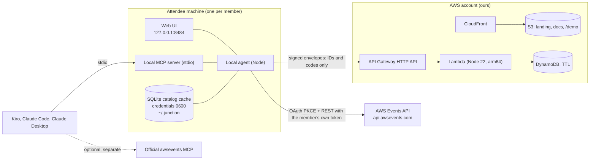

# 02. Architecture

## Shape

Three things live in three trust zones.

| Zone | What runs | Holds secrets | Sees catalog | Talks to Events API |
|---|---|---|---|---|
| Attendee machine | Local agent, web UI, MCP server | Events API tokens, member private key | Yes, its own copy | Yes |
| AWS account (ours) | Static site, squad server | None of the members' | No | Never |
| Browser on the hosted demo | Same UI compiled in demo mode | None | Fictional data only | No, no network calls at all |

## Why nothing can be hosted that calls the Events API

The API signs attendees in with OAuth code plus PKCE, and the redirect URIs are six reserved loopback addresses on ports 8484 to 8489, matched exactly with no wildcards. The documentation says there is no hosted redirect URI and that an application which signs attendees in has to run locally. Junction is therefore a local agent by necessity. What can be hosted safely is everything that never touches Events API credentials.

## Components

### Local agent (`packages/agent`)

- Sign-in: PKCE verifier from a CSPRNG, `state`, loopback listener with port fallback, token storage in `~/.junction/credentials.json` (0600), refresh serialised so two refreshes never race.
- Events API client: typed, zod-validated, per-operation token buckets, `Retry-After` handling, closed-operation handling, reconcile-before-retry for writes.
- Catalog store: SQLite with snapshots, diffs, lazy abstracts, repeat groups, venue normaliser.
- Sync: reads `GetSchedule`, builds and signs the member's manifest, pulls and verifies the others, runs the solver, stores proposals.
- Local HTTP server: serves the built web UI and a small JSON API. **Defences:** bind to `127.0.0.1` only, check the `Host` header against an allowlist (blocks DNS rebinding), require a random per-launch secret in a header for every state-changing call, reject requests whose `Origin` is not the server itself, set a strict CSP.
- CLI: `junction login`, `logout`, `sync`, `catalog stats`, `squad create|join|approve|leave`, `export`, `import`, `ui`, `mcp`, `doctor`.

### Core (`packages/core`)

Pure TypeScript, no I/O, no clock, no randomness. Schemas, canonical JSON, signing helpers, code parser, repeat groups, coverage, solver, claim rule, venue graph. Everything the determinism guarantee depends on lives here and nowhere else.

### Web UI (`packages/web`)

React and Vite, plain CSS on `design/tokens.css`. Two builds: the agent-served app (talks to the local agent) and the demo build (fictional fixtures, no network, deployed to `/demo`). Same components, different data source behind one interface.

### Local MCP server (`packages/mcp`)

stdio server using the MCP SDK, reads only local state. Complements the official `awsevents` MCP server; it does not proxy it.

### Squad server (`packages/relay` and `infra`)

A mailbox. API Gateway HTTP API, one Lambda with a small router, DynamoDB single table on-demand with TTL. It verifies signatures, enforces membership from the latest signed charter, stores envelopes, and performs conditional writes for claims. It cannot read anything sensitive because nothing sensitive is sent.

## AWS infrastructure (CDK v2, TypeScript, `infra/`)

Dedicated AWS account, region **us-east-1** (CloudFront certificates live there). Bootstrap once with `cdk bootstrap`. Two stacks.

**JunctionSiteStack**
- S3 bucket, private, Block Public Access on, versioning off, with CloudFront Origin Access Control.
- CloudFront distribution, HTTP/2 and 3, default root object, SPA fallback for `/demo/*`, compression, a response headers policy with `Content-Security-Policy: default-src 'self'; img-src 'self' data:; font-src 'self'; style-src 'self'; script-src 'self'; connect-src 'self'; frame-ancestors 'none'`, HSTS, `X-Content-Type-Options`, `Referrer-Policy: no-referrer`.
- Optional custom domain: `DOMAIN_NAME` and `HOSTED_ZONE_ID` context values; when absent use the CloudFront domain. ACM certificate in us-east-1 with DNS validation.
- Deployment: `BucketDeployment` from `packages/web/dist` (site) and `packages/web/dist-demo` (under `/demo`), with cache invalidation.

**JunctionRelayStack**
- DynamoDB table `junction`, on-demand, PK `pk` (string), SK `sk` (string), TTL attribute `ttl`, point-in-time recovery off (data is disposable), deletion protection off, removal policy DESTROY.
- Lambda `relay` (NodejsFunction, Node 22, arm64, 256 MB, timeout 10 s, reserved concurrency 20, no VPC, log retention 30 days, `NODE_OPTIONS=--enable-source-maps`).
- API Gateway HTTP API, routes in docs/03, default throttling rate 20 and burst 40, CORS closed (the agent calls server-side, browsers never call it), access logs without bodies.
- Alarms: Lambda errors and throttles, API 5xx, DynamoDB throttled requests, all to an SNS topic with the owner's email.
- AWS Budgets: monthly cost budget at 25 USD with 50, 80 and 100 percent alerts.
- Outputs: API URL, site URL, table name.

Estimated cost during the hackathon: under 5 USD a month, dominated by CloudFront and any custom domain.

## Data flows

**Sign-in.** UI or CLI starts the agent listener, opens `https://oauth.awsevents.com/oauth2/authorize` with PKCE, Builder ID sign-in happens in the browser, the browser returns a code to `localhost`, the agent exchanges it at the token endpoint, stores tokens, and never transmits them anywhere else.

**Sync (every few minutes and on demand).** `GetSchedule` (60 per minute) → build and sign manifest → `PUT` to the squad server (or write a file) → pull other members' envelopes → verify signatures and sequence numbers → run solver → store proposals → UI updates.

**Accept a proposal.** UI asks the agent → agent performs the member's own writes (`AssociateFavorites`, `ReserveSessions`, `CancelReservation`, `CreatePersonalTime`) within quota → `GetSchedule` to confirm → report per-session results → next manifest reflects the change.

**Launch reactor.** Catalog poll → diff shows new sessions → classify → claim rule ranks eligible members → owner is prompted first, others after their grace period → claim posted to the squad server with a conditional write → winner returned to every loser.

## Security and threat model

| Threat | Mitigation |
|---|---|
| Squad server compromised or curious | Only signed IDs and codes are stored. It cannot forge manifests (Ed25519 keys are local). At worst it withholds or drops messages, which degrades to file exchange. |
| Malicious or removed member | Membership comes from the leader-signed charter. Removed members' envelopes are rejected after the new charter propagates. Manifests are ignored if `seq` is stale. |
| Leaked invite code | The leader approves every join request. Invite secrets are single-squad and can be rotated by publishing a new charter with a new verifier. |
| Replay of signed requests | Timestamp window of 120 seconds plus a nonce recorded with a 10 minute TTL by a conditional put. |
| Token theft on the attendee machine | 0600 file, never logged, never sent off machine, `.claude/settings.json` denies reading `~/.junction/**`, sign-out revokes the refresh token. |
| Other websites attacking the local agent | Loopback bind, Host allowlist, per-launch secret, Origin check, strict CSP, no permissive CORS. |
| Catalog leakage | Titles and abstracts stay in the local store and are never serialised into manifests or logs. Repo hygiene enforced by `.gitignore`, a pre-commit check and the `guardian` subagent. |
| Supply chain | Lockfile, pinned versions, `npm audit` in CI, no postinstall scripts from unknown packages, Dependabot, provenance when publishing. |
| Abuse of the public squad server | Throttling, small payload cap (64 KB), reserved concurrency, budget alarm, TTL on everything. |

## Decision records

| ID | Decision | Why |
|---|---|---|
| ADR-001 | Local agent, not a hosted app | The API only supports loopback sign-in and says there is no hosted option. |
| ADR-002 | Identity is a keypair per member, not accounts | No sign-up, no passwords, nothing to breach. Builder ID stays with the Events API. |
| ADR-003 | Deterministic solver on every machine, no coordinator | Removes a trusted central party and works offline. |
| ADR-004 | Squad server is an optional mailbox | Resilience and privacy. File and paste always work. |
| ADR-005 | Manifests carry IDs and codes only | The catalog is not public. Minimises what could ever leak. |
| ADR-006 | TypeScript monorepo, Node 22, npm workspaces | One language across agent, core, relay, web and infra. |
| ADR-007 | Plain CSS on tokens, no UI kit | Distinct look, no template tells. See docs/05. |
| ADR-008 | SQLite for the local catalog | Diffs and queries over about 2,000 sessions with zero setup. |
| ADR-009 | Demo mode is a build of the same UI with no network | Judges can try it without signing in and without catalog data. |
| ADR-010 | us-east-1, dedicated account, CDK | CloudFront certificate location, clean blast radius, repeatable deploys. |
| ADR-011 | Working name "Junction" | Lines meet at a junction. Trivial to rename; keep the name in one constants file. |

Add new records here as they are made.

## Deployment steps

1. `aws sso login --profile <profile>` and `export AWS_PROFILE=<profile>`.
2. `npm run build` (agent, web, web demo, relay).
3. `npx cdk bootstrap aws://<account>/us-east-1` (first time only).
4. `npm run infra:diff`, review, then `npm run infra:deploy`.
5. Smoke tests: site loads, `/demo` runs with the network tab empty, relay `GET /v1/health` returns 200, a signed test envelope round-trips, an unsigned one is rejected.
6. Run the `guardian` subagent. It must pass before announcing the URL.
